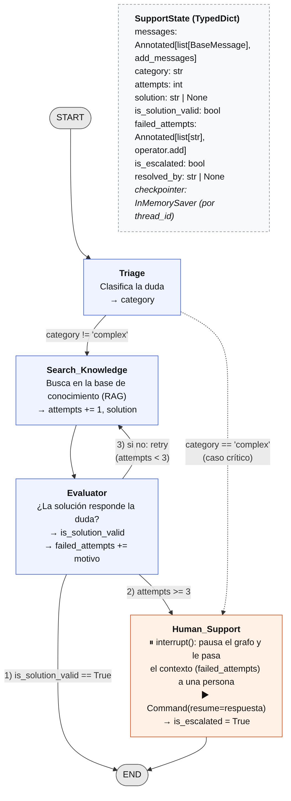

# Módulo 5 · Agentes con LangGraph

## Ejercicio: Diseño de un grafo de soporte técnico multinivel

📁 [`ejercicio-diseno-grafo/`](ejercicio-diseno-grafo/)

Diagrama y esquema del estado (`TypedDict`) de un asistente de soporte. Clasifica la duda (Triage), busca una solución (Search_Knowledge), la valida (Evaluator) y, si no sirve, vuelve a buscar: ese es el **ciclo**. Después de 3 intentos fallidos, o si el caso es crítico, lo escala a una persona (Human_Support): el grafo se pausa con `interrupt()` hasta que esa persona responde (*human-in-the-loop* con checkpoints), y le pasa el historial de por qué fallaron los intentos. Incluye la implementación ejecutable con LangGraph, que recorre los tres caminos posibles.



## Ejercicio: Tool Calling con contrato validado

📁 [`ejercicio-tool-calling/`](ejercicio-tool-calling/)

`search_knowledge_base` es una herramienta asíncrona de LangChain (`@tool(args_schema=SearchInput)`) que un agente puede invocar para buscar en la base de conocimiento.

- **Contrato de entrada (`SearchInput`):** `query` (de 3 a 500 caracteres; se limpian los espacios de más) y `limit` (de 1 a 10, por defecto 3). Pydantic valida los argumentos que manda el LLM **antes** de que la función toque la base de datos: un `limit` de 50 se rechaza.
- **Descripción para el LLM:** el docstring explica qué busca, cuándo conviene usarla (preguntas sobre reglas y procesos propios de la empresa), cuándo no (saludos, cálculos, temas generales) y qué devuelve. Es lo que el modelo lee para decidir si la llama.
- **Errores:** la búsqueda corre dentro de un `try` con un timeout de 10 segundos. Si la base falla o tarda demasiado, la herramienta no corta la ejecución: devuelve un texto que empieza con `"Error:"`, para que el LLM le explique al usuario qué pasó en lugar de inventar una respuesta.

**Estructura:**

| Archivo | Contenido |
|---|---|
| `search_tool.py` | Solo la definición de la herramienta (`SearchInput` y `search_knowledge_base`): es lo que importa un agente |
| `demo.py` | Demostración manual: contrato, llamada válida, `limit=50` rechazado y base caída |
| `tests/test_search_tool.py` | 12 tests con pytest que automatizan esas mismas verificaciones |

```bash
cd modulo-05-langgraph/ejercicio-tool-calling
python demo.py
python -m pytest -q
```

Salida de `demo.py`:

```
search_knowledge_base {'query': {'description': "Pregunta o tema a buscar, ...", 'maxLength': 500, 'minLength': 3, ...}, 'limit': {'default': 3, 'description': 'Cantidad máxima de fragmentos a devolver, entre 1 y 10. Por defecto, 3.', 'maximum': 10, 'minimum': 1, ...}}
['Resultado para políticas de vacaciones']
Validation error: ('limit',) -> Input should be less than or equal to 10
Search failed for 'políticas de vacaciones': ConnectionError: vector store unreachable
Error: no se pudo consultar la base de conocimiento (ConnectionError).
```

**Tests** (reemplazan la base por versiones simuladas con `monkeypatch`):

| Grupo | Qué verifican |
|---|---|
| Contrato | Nombre, descripción, campos `query` y `limit` con sus descripciones y límites |
| Éxito | La búsqueda devuelve resultados y recibe los argumentos correctos; `limit` vale 3 por defecto; la `query` llega sin espacios de más; sin resultados, devuelve un mensaje |
| Entrada inválida | `limit` 50 o 0, `query` muy corta, solo espacios o ausente: se rechaza con `ValidationError` y **la base nunca se consulta** |
| Base caída | Un `ConnectionError` o un error inesperado vuelve como texto `"Error: ..."` en lugar de cortar la ejecución; una base lenta corta por timeout |

## Ejercicio: Ciclo ReAct y persistencia con checkpoints

📁 [`ejercicio-react-checkpoints/`](ejercicio-react-checkpoints/)

Agente climatológico que razona si necesita una herramienta y recuerda la conversación gracias a un checkpointer.

```
START → agent ──(el LLM pidió una herramienta)──► tools ──┐
          ▲                                               │
          └───────────────(observación)───────────────────┘
        agent ──(sin tool_calls: respuesta final)──► END
```

- **Ciclo ReAct:** el nodo `agent` llama al LLM con las herramientas vinculadas (`bind_tools`). `tools_condition` revisa si la respuesta trae `tool_calls`: si los trae, va al nodo `tools`; si no, termina. `ToolNode` ejecuta la herramienta y devuelve un `ToolMessage` con el mismo `tool_call_id`, que vuelve al agente: esa es la **observación**. El grafo termina solo cuando el LLM decide que no necesita más herramientas, y `recursion_limit=10` evita un loop infinito.
- **Estado acumulativo:** `messages: Annotated[list[BaseMessage], add_messages]`. Cada nodo devuelve solo sus mensajes nuevos, que se agregan al historial.
- **Persistencia:** el grafo se compila con `MemorySaver()`, que guarda una "foto" del estado después de cada nodo, separada por `thread_id`. Un segundo mensaje en el mismo thread recibe toda la conversación anterior; un thread nuevo empieza de cero.
- **Proveedor:** la consigna usa OpenAI (`gpt-4o-mini`). Esta versión usa Gemini por defecto, con un modelo de respaldo si el principal está saturado; con `LLM_PROVIDER=openai` usa OpenAI. Para una corrida más rápida: `GEMINI_MODEL=gemini-flash-lite-latest python weather_agent.py`.
- **Diseño:** el modelo no se guarda en el estado. Se pasa a `build_graph(model)`, así los tests pueden usar un modelo simulado.

```bash
cd modulo-05-langgraph/ejercicio-react-checkpoints
python weather_agent.py
python -m pytest -q
```

**Corrida real** (`gemini-flash-lite-latest`). Además de los dos pasos de la consigna, el script hace una prueba de memoria que no depende de que el modelo adivine: pregunta algo que solo se puede responder con el historial.

```
--- Paso 1 ---
[thread=dev_test_01] usuario: ¿Qué tiempo hace en Madrid?
   herramienta: get_weather({'location': 'Madrid'}) -> Soleado, 22°C
   agente: Actualmente en Madrid está soleado y la temperatura es de 22°C.
   mensajes guardados en el thread: 4

--- Paso 2 ---
[thread=dev_test_01] usuario: ¿Y en Londres?
   herramienta: get_weather({'location': 'Londres'}) -> Nublado con lloviznas, 14°C
   agente: Actualmente en Londres el tiempo está nublado con lloviznas y la temperatura es de 14°C.
   mensajes guardados en el thread: 8

--- Paso 3 (mismo thread_id: recuerda) ---
[thread=dev_test_01] usuario: ¿Cuál fue la primera ciudad por la que te pregunté?
   agente: La primera ciudad por la que me preguntaste fue **Madrid**.
   mensajes guardados en el thread: 10

--- Paso 4 (otro thread_id: sin memoria) ---
[thread=otro_thread_02] usuario: ¿Cuál fue la primera ciudad por la que te pregunté?
   agente: Esta es nuestra primera interacción, así que aún no me habías preguntado por ninguna ciudad. ¿De cuál te gustaría saber el clima?
   mensajes guardados en el thread: 2
```

- **Paso 2:** "¿Y en Londres?" se entiende como una pregunta por el clima porque el LLM recibe toda la conversación del paso 1. El historial se concatena: 4 → 8 mensajes.
- **Por qué hay un paso 3 y un paso 4:** en una primera versión, el control era repetir "¿Y en Londres?" en otro thread, y el modelo usaba la herramienta igual. No lo recordaba: como su única herramienta es la del clima, adivinaba la intención. La pregunta "¿cuál fue la primera ciudad?" no se puede adivinar. En el mismo thread responde Madrid; en otro thread, el agente no tiene historial y lo dice.
- **Tiempos:** cada llamada al LLM tiene un timeout de 60 segundos y 2 reintentos (por defecto, el SDK reintenta 6 veces sin timeout). Así, si el modelo principal está saturado, el agente pasa rápido al de respaldo en lugar de quedar esperando varios minutos.

**Tests** (5, con un modelo simulado que decide según el historial, sin API):

- el contrato de la herramienta;
- el ciclo completo `HumanMessage → AIMessage(tool_call) → ToolMessage → AIMessage(final)` y el `tool_call_id` que conecta la llamada con su resultado;
- que el mismo thread recuerda el contexto (8 mensajes después de dos turnos, y "¿Y en Londres?" usa la herramienta);
- que un thread nuevo no tiene memoria (2 mensajes, y el agente no entiende la pregunta);
- que el checkpointer guarda un checkpoint por paso (la base del *time travel*).
