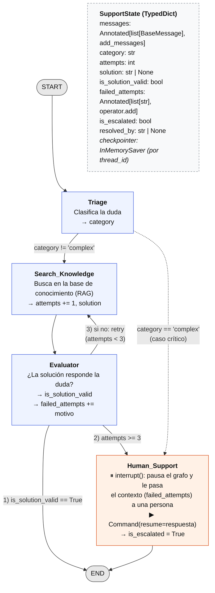

# Ejercicio: Diseño de un grafo de soporte técnico multinivel

Diseño de un **asistente de soporte técnico multinivel** como grafo de estado de LangGraph. El asistente:

1. Clasifica la duda del usuario.
2. Busca una solución en la base de conocimientos.
3. Valida si la solución sirve.
4. Si no sirve, vuelve a buscar.
5. Después de 3 intentos fallidos, o si el caso es crítico, lo escala a una persona, **pausando el grafo** hasta que esa persona responda (*human-in-the-loop*).

| Archivo | Contenido |
|---|---|
| `diagrama.mmd` | El diagrama, en Mermaid (se puede pegar en [mermaid.live](https://mermaid.live)) |
| `diagrama.png` | El diagrama renderizado |
| `support_graph.py` | El mismo grafo implementado y ejecutable (opcional, no requiere API keys) |

## Diagrama



- Las **cajas** son nodos y las **flechas**, aristas.
- Las flechas con texto son **aristas condicionales**: el texto indica cuándo se toma cada camino.
- La flecha `retry`, que vuelve de Evaluator a Search_Knowledge, es el **ciclo**.
- La caja punteada es el estado; los nodos indican qué campos escriben (`→ campo`).

## Estado (State)

```python
import operator
from typing import Annotated, List, Optional, TypedDict
from langchain_core.messages import BaseMessage
from langgraph.graph.message import add_messages

class SupportState(TypedDict):
    messages: Annotated[List[BaseMessage], add_messages]   # historial de la conversación
    category: str                 # clasificación que asigna Triage ("account", "billing", "complex"...)
    attempts: int                 # cuántas búsquedas se hicieron
    solution: Optional[str]       # última solución encontrada por Search_Knowledge
    is_solution_valid: bool       # veredicto de Evaluator sobre esa solución
    failed_attempts: Annotated[List[str], operator.add]    # auditoría: por qué falló cada intento
    is_escalated: bool            # True cuando el caso pasa a una persona
    resolved_by: Optional[str]    # "agent" o "human"
```

| Campo | Lo escribe | Lo lee |
|---|---|---|
| `messages` | El usuario (entrada), Evaluator (respuesta) y Human_Support (respuesta de la persona) | Triage |
| `category` | Triage | Search_Knowledge y la arista condicional de Triage |
| `attempts` | Search_Knowledge (suma 1 en cada búsqueda) | La arista condicional de Evaluator |
| `solution` | Search_Knowledge | Evaluator |
| `is_solution_valid` | Evaluator | La arista condicional de Evaluator |
| `failed_attempts` | Evaluator (motivo de cada rechazo) y Triage (caso crítico) | Human_Support |
| `is_escalated`, `resolved_by` | Human_Support / Evaluator | Resultado final |

- **`messages` usa el reducer `add_messages`.** Cada nodo devuelve solo sus mensajes nuevos, y LangGraph los **agrega** al historial en lugar de reemplazarlo. Sin el reducer, cada respuesta borraría la conversación anterior.
- **`failed_attempts` usa el reducer `operator.add`**, que concatena listas: cada intento fallido **suma** su motivo al historial. Sin el reducer, el tercer intento pisaría a los dos anteriores y la persona solo vería el último.
- **Los demás campos se sobrescriben.** Cada nodo devuelve solo los campos que cambia, y LangGraph fusiona esa actualización con el estado.

## Auditoría de intentos fallidos

Cada vez que Evaluator rechaza una solución, anota **por qué** en `failed_attempts`, por ejemplo: `"intento 1 (account): la solución es genérica, no indica una acción concreta"`. Triage también anota cuando deriva un caso crítico sin buscar. Así, cuando el caso llega a Human_Support, la persona recibe el contexto completo: qué se probó y por qué no alcanzó, sin tener que empezar de cero ni volver a preguntarle todo al usuario.

## Human-in-the-loop con checkpoints

Human_Support no "simula" la respuesta: **pausa el grafo** hasta que una persona responde.

1. El grafo se compila con un **checkpointer** (`InMemorySaver`, antes llamado `MemorySaver`), que guarda el estado después de cada paso, separado por `thread_id`. Cada ticket es un thread.
2. Human_Support llama a `interrupt({...})` con el contexto del caso: la pregunta, la categoría y `failed_attempts`. El grafo se detiene ahí, y `invoke` devuelve ese contexto en `result["__interrupt__"]`. `app.get_state(config).next` muestra que quedó esperando en `('human_support',)`.
3. Cuando la persona responde, minutos u horas después, se reanuda **el mismo thread** con `app.invoke(Command(resume=respuesta), config)`. `interrupt()` devuelve esa respuesta, y el nodo la agrega a `messages` y marca `is_escalated=True`.

```python
config = {"configurable": {"thread_id": "ticket-2"}}
result = app.invoke(initial_state(pregunta), config)          # se pausa en human_support
contexto = result["__interrupt__"][0].value                  # lo que ve la persona de soporte
result = app.invoke(Command(resume="Ya iniciamos la devolución..."), config)   # se reanuda
```

**Detalle importante:** al reanudar, el nodo que llamó a `interrupt()` se ejecuta **de nuevo desde el principio**. Por eso, el código anterior al `interrupt()` no debe tener efectos secundarios (mandar un mail, crear un ticket), porque se ejecutaría dos veces.

`InMemorySaver` guarda el estado en memoria: sirve para desarrollo. En producción se usa un checkpointer persistente (SQLite o Postgres), para que un caso pausado sobreviva a un reinicio del servidor.

## Lógica de las aristas condicionales

**Después de Evaluator** (la que pide la consigna). Las condiciones se evalúan **en este orden**:

| # | Condición | Destino | Por qué |
|---|---|---|---|
| 1 | `is_solution_valid == True` | **END** | La solución responde la duda |
| 2 | `attempts >= 3` | **Human_Support** | Falló 3 veces: hay que derivar el caso |
| 3 | En otro caso (`attempts < 3`) | **Search_Knowledge** | Intenta otra búsqueda: es el **ciclo** |

El orden importa: si la tercera búsqueda encuentra una solución válida, el caso termina resuelto en vez de escalarse. La condición 2 es el **freno de seguridad** del ciclo: garantiza que el grafo siempre llegue a END y nunca quede en un loop infinito.

**Después de Triage** (agregada por el escenario: "si no es útil **o es muy compleja**, se escala"):

| Condición | Destino |
|---|---|
| `category == "complex"` (caída de producción, pérdida de datos, seguridad) | **Human_Support**, sin buscar |
| En otro caso | **Search_Knowledge** |

Un caso crítico no debería esperar 3 búsquedas fallidas para llegar a una persona.

## Criterios de aceptación

| Criterio | Cómo se cumple |
|---|---|
| Notación clara | Nodos como cajas, aristas como flechas, y las condiciones escritas sobre las flechas |
| START y END explícitos | Los dos aparecen como nodos terminales |
| Al menos un ciclo | Evaluator → Search_Knowledge (`retry`) |
| Lógica de la arista condicional | Las tablas de arriba, también escritas sobre las flechas del diagrama |
| Estado con tipos de Python | `SupportState` (`TypedDict` con `Annotated`, `List`, `Optional`, `int`, `bool`, `str`) |
| Todos los caminos llegan a END | Por la solución válida, o por Human_Support → END |
| Mejoras de la devolución | Auditoría con `failed_attempts`, grafo en código con `StateGraph(SupportState)`, función `route_after_evaluation` con las tres salidas, y *human-in-the-loop* con `interrupt` + checkpointer |

## Implementación

`support_graph.py` implementa este mismo grafo con `StateGraph(SupportState)`. Las funciones de las aristas condicionales son `route_after_triage` y `route_after_evaluation`. Los nodos están simulados, así que corre sin API keys:

```bash
pip install langgraph
python modulo-05-langgraph/ejercicio-diseno-grafo/support_graph.py
```

Prueba los tres caminos posibles:

```
=== No puedo iniciar sesión, creo que me olvidé la contraseña
[triage] category=account
[search] attempt 1 -> Revisá que el usuario esté bien escrito.
[evaluator] valid=False (la solución es genérica, no indica una acción concreta: «Revisá que el usuario esté bien escrito.»)
[search] attempt 2 -> Usá 'Olvidé mi contraseña' en la pantalla de login para recibir un enlace de recuperación.
[evaluator] valid=True
→ resolved_by=agent | attempts=2 | is_escalated=False | messages=2

=== Me cobraron dos veces la suscripción
[triage] category=billing
[search] attempt 1 -> no result
[evaluator] valid=False (la base de conocimiento no tiene artículos para esta categoría)
[search] attempt 2 -> no result
[evaluator] valid=False (la base de conocimiento no tiene artículos para esta categoría)
[search] attempt 3 -> no result
[evaluator] valid=False (la base de conocimiento no tiene artículos para esta categoría)
⏸  paused at ('human_support',) — handoff for the human agent:
     - intento 1 (billing): la base de conocimiento no tiene artículos para esta categoría
     - intento 2 (billing): la base de conocimiento no tiene artículos para esta categoría
     - intento 3 (billing): la base de conocimiento no tiene artículos para esta categoría
[human] answered: Revisé tu cuenta: hubo un doble cobro. Ya iniciamos la devolución, la vas a ver en 5 días hábiles.
→ resolved_by=human | attempts=3 | is_escalated=True | messages=2

=== Hay una caída en producción y los clientes no pueden pagar
[triage] category=complex
⏸  paused at ('human_support',) — handoff for the human agent:
     - triage: caso crítico (posible caída o impacto en producción), sin búsqueda
[human] answered: Confirmamos el incidente y el equipo de guardia ya lo está resolviendo. Te avisamos al terminar.
→ resolved_by=human | attempts=0 | is_escalated=True | messages=2
```

1. **Resuelto con el ciclo**: la primera solución no sirve, la segunda búsqueda sí.
2. **Escalado después de 3 intentos**: el grafo se pausa y la persona recibe los 3 motivos de fallo.
3. **Escalado directo desde Triage**: el caso crítico no pasa por la búsqueda.

En los tres casos `messages` termina con 2 mensajes, la pregunta y la respuesta: el reducer los fue agregando. El script imprime al final el diagrama que LangGraph genera desde el grafo compilado (`app.get_graph().draw_mermaid()`), lo que confirma que el código y el diseño coinciden.
