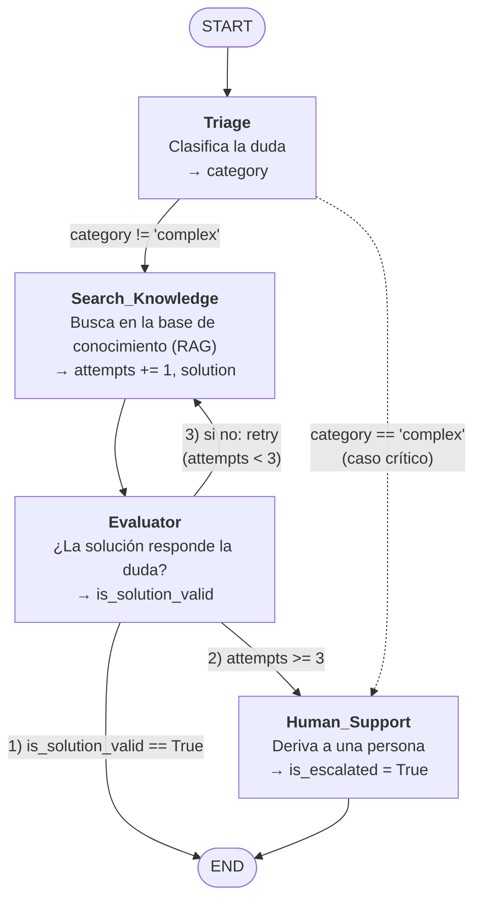

# Ejercicio: Diseño de un grafo de soporte técnico multinivel

Diseño de un **asistente de soporte técnico multinivel** como grafo de estado de LangGraph. El asistente:

1. Clasifica la duda del usuario.
2. Busca una solución en la base de conocimientos.
3. Valida si la solución sirve.
4. Si no sirve, vuelve a buscar.
5. Después de 3 intentos fallidos, o si el caso es crítico, lo escala a una persona.

| Archivo | Contenido |
|---|---|
| `diagrama.mmd` | El diagrama, en Mermaid (se puede pegar en [mermaid.live](https://mermaid.live)) |
| `diagrama.png` | El diagrama renderizado |
| `support_graph.py` | El mismo grafo implementado y ejecutable (opcional, no requiere API keys) |

## Diagrama



- Las **cajas** son nodos y las **flechas**, aristas.
- Las flechas con texto son **aristas condicionales**: el texto indica cuándo se toma cada camino.
- La flecha `retry`, que vuelve de Evaluator a Search_Knowledge, es el **ciclo**.

## Estado (State)

```python
from typing import Annotated, List, Optional, TypedDict
from langchain_core.messages import BaseMessage
from langgraph.graph.message import add_messages

class SupportState(TypedDict):
    messages: Annotated[List[BaseMessage], add_messages]   # historial de la conversación
    category: str                 # clasificación que asigna Triage ("account", "billing", "complex"...)
    attempts: int                 # cuántas búsquedas se hicieron
    solution: Optional[str]       # última solución encontrada por Search_Knowledge
    is_solution_valid: bool       # veredicto de Evaluator sobre esa solución
    is_escalated: bool            # True cuando el caso pasa a una persona
```

| Campo | Lo escribe | Lo lee |
|---|---|---|
| `messages` | El usuario (entrada), Evaluator (respuesta) y Human_Support (aviso de derivación) | Triage |
| `category` | Triage | Search_Knowledge y la arista condicional de Triage |
| `attempts` | Search_Knowledge (suma 1 en cada búsqueda) | La arista condicional de Evaluator |
| `solution` | Search_Knowledge | Evaluator |
| `is_solution_valid` | Evaluator | La arista condicional de Evaluator |
| `is_escalated` | Human_Support | Resultado final |

- **`messages` usa el reducer `add_messages`.** Cada nodo devuelve solo sus mensajes nuevos, y LangGraph los **agrega** al historial en lugar de reemplazarlo. Sin el reducer, cada respuesta borraría la conversación anterior.
- **Los demás campos se sobrescriben.** Cada nodo devuelve solo los campos que cambia, y LangGraph fusiona esa actualización con el estado.

## Lógica de las aristas condicionales

**Después de Evaluator** (la que pide la consigna). Las condiciones se evalúan **en este orden**:

| # | Condición | Destino | Por qué |
|---|---|---|---|
| 1 | `is_solution_valid == True` | **END** | La solución responde la duda |
| 2 | `attempts >= 3` | **Human_Support** | Falló 3 veces: hay que derivar el caso |
| 3 | En otro caso (`attempts < 3`) | **Search_Knowledge** | Intenta otra búsqueda: es el **ciclo** |

El orden importa: si la tercera búsqueda encuentra una solución válida, el caso termina resuelto en vez de escalarse. La condición 2 es el **freno de seguridad** del ciclo: garantiza que el grafo siempre llegue a END y nunca quede en un loop infinito.

**Después de Triage** (agregada por el escenario: "si no es útil **o es muy compleja**, se escala"):

| Condición | Destino |
|---|---|
| `category == "complex"` (caída de producción, pérdida de datos, seguridad) | **Human_Support**, sin buscar |
| En otro caso | **Search_Knowledge** |

Un caso crítico no debería esperar 3 búsquedas fallidas para llegar a una persona.

## Criterios de aceptación

| Criterio | Cómo se cumple |
|---|---|
| Notación clara | Nodos como cajas, aristas como flechas, y las condiciones escritas sobre las flechas |
| START y END explícitos | Los dos aparecen como nodos terminales |
| Al menos un ciclo | Evaluator → Search_Knowledge (`retry`) |
| Lógica de la arista condicional | Las tablas de arriba, también escritas sobre las flechas del diagrama |
| Estado con tipos de Python | `SupportState` (`TypedDict` con `Annotated`, `List`, `Optional`, `int`, `bool`, `str`) |
| Todos los caminos llegan a END | Por la solución válida, o por Human_Support → END |

## Implementación (opcional)

`support_graph.py` implementa este mismo grafo. Los nodos están simulados, así que corre sin API keys:

```bash
pip install langgraph
python modulo-05-langgraph/ejercicio-diseno-grafo/support_graph.py
```

Prueba los tres caminos posibles:

```
=== No puedo iniciar sesión, creo que me olvidé la contraseña
[triage] category=account
[search] attempt 1 -> Revisá que el usuario esté bien escrito.
[evaluator] valid=False
[search] attempt 2 -> Usá 'Olvidé mi contraseña' en la pantalla de login para recibir un enlace de recuperación.
[evaluator] valid=True
→ attempts=2 | is_escalated=False | messages=2 | ...

=== Me cobraron dos veces la suscripción
[triage] category=billing
[search] attempt 1 -> no result
[evaluator] valid=False
[search] attempt 2 -> no result
[evaluator] valid=False
[search] attempt 3 -> no result
[evaluator] valid=False
[human] escalated after 3 attempt(s), category=billing
→ attempts=3 | is_escalated=True | messages=2 | ...

=== Hay una caída en producción y los clientes no pueden pagar
[triage] category=complex
[human] escalated after 0 attempt(s), category=complex
→ attempts=0 | is_escalated=True | messages=2 | ...
```

1. **Resuelto con el ciclo**: la primera solución no sirve, la segunda búsqueda sí.
2. **Escalado después de 3 intentos**: el ciclo se corta con el freno de seguridad.
3. **Escalado directo desde Triage**: el caso crítico no pasa por la búsqueda.

En los tres casos `messages` termina con 2 mensajes, la pregunta y la respuesta: el reducer los fue agregando. El script imprime al final el diagrama que LangGraph genera desde el grafo compilado (`app.get_graph().draw_mermaid()`), lo que confirma que el código y el diseño coinciden.
