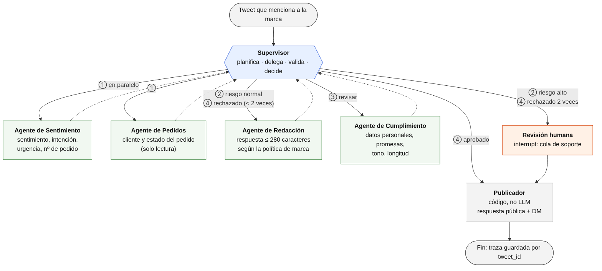

# Módulo 6 · Sistemas multi-agente

## Ejercicio: Topología jerárquica para respuesta automatizada a quejas

📁 [`ejercicio-topologia-jerarquica/`](ejercicio-topologia-jerarquica/)

Propuesta arquitectónica de un sistema que recibe quejas de clientes por Twitter, analiza el sentimiento, verifica el pedido en la base de datos y responde de forma personalizada. Lo resuelven un **supervisor** y cuatro especialistas: Sentimiento, Pedidos, Redacción y Cumplimiento. El documento incluye:

- las responsabilidades, herramientas y contratos de cada agente;
- el estado compartido;
- el flujo paso a paso, con un ejemplo;
- la justificación de la topología jerárquica frente a la cooperativa, y cómo se mitigan sus riesgos.



## Ejercicio: Patrón Supervisor con delegación dinámica

📁 [`ejercicio-patron-supervisor/`](ejercicio-patron-supervisor/)

Un supervisor (LLM) decide en cada paso qué especialista trabaja, el Analista o el Escritor, y cuándo terminar. El supervisor **coordina**: no analiza ni escribe.

```
START → supervisor ──(Analista)──► Analista ──┐
            ▲       ──(Escritor)──► Escritor ──┤
            └──────────────────────────────────┘
        supervisor ──(FINALIZAR)──► END
```

- **Estado:** `messages` (con el reducer `add_messages`) y `next`, la última decisión del supervisor.
- **Decisión estructurada:** el supervisor usa `with_structured_output(Route)`, un `TypedDict` con `next_agent: Literal["Analista", "Escritor", "FINALIZAR"]` y un `reason`. El modelo solo puede devolver una de esas tres rutas.
- **Prompt de sistema:** fija el orden con reglas que el supervisor verifica en el historial, buscando los mensajes con nombre `Analista` o `Escritor`, y aclara explícitamente cuándo responder `FINALIZAR` para no entrar en un bucle.
- **Resguardos:** si el LLM devuelve una ruta inválida, el grafo termina en lugar de romperse; y `recursion_limit=10` corta cualquier bucle.
- **Proveedor:** la consigna usa OpenAI. Esta versión usa Gemini por defecto, con un modelo de respaldo; con `LLM_PROVIDER=openai` usa `gpt-4o-mini`.

```bash
cd ejercicio-patron-supervisor
python supervisor.py
python -m pytest -q
```

Salida:

```
Usuario: Necesito un reporte sobre ventas.

[supervisor] decide: Analista
[Analista] Datos procesados: +20% incremento.
[supervisor] decide: Escritor
[Escritor] El informe está listo: Crecimiento positivo.
[supervisor] decide: FINALIZAR

Secuencia: supervisor → Analista → supervisor → Escritor → supervisor → fin
```

**Tests** (6, con un router simulado, sin API):

- la secuencia esperada;
- que el supervisor recibe su prompt y todo el historial;
- que el estado final tiene los aportes de los dos especialistas;
- que un pedido sin relación con un informe termina sin llamar especialistas;
- que una ruta inválida termina sin romper el grafo;
- que un supervisor que nunca dice `FINALIZAR` se corta por el `recursion_limit`.
