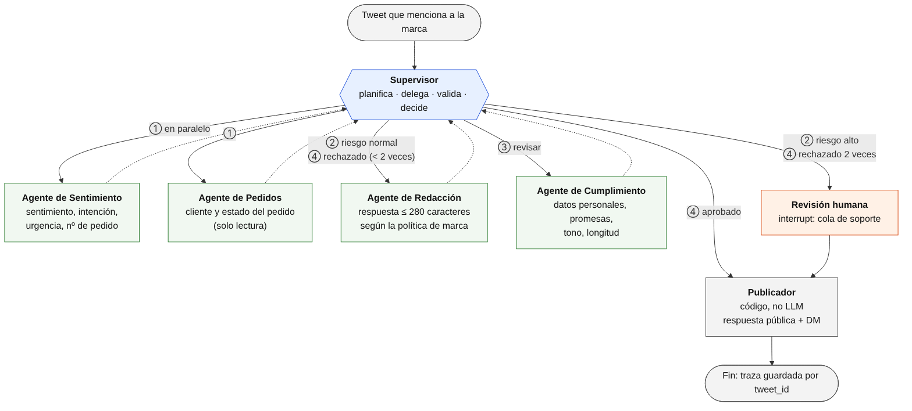
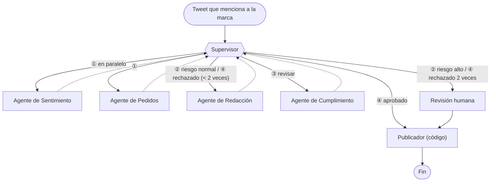

# Propuesta arquitectónica: respuesta automatizada a quejas en Twitter

**Topología:** jerárquica (patrón Supervisor) · **Módulo 6** · Topologías multi-agente

## 1. Contexto y objetivo

Una empresa de e-commerce recibe quejas de clientes que mencionan a la marca en Twitter. El sistema tiene que:

1. Entender **qué siente y qué necesita** el cliente.
2. Verificar el **estado real de su pedido** en la base de datos.
3. Responder de forma **personalizada, rápida y segura**: es una respuesta pública que ve todo el mundo.

Hay dos restricciones que condicionan el diseño:

- **Todo lo que se publica es irreversible e impacta en la marca.** Un tweet con datos personales, una promesa que la empresa no puede cumplir o un tono inadecuado no se pueden "deshacer".
- **El flujo es casi siempre el mismo** (entender → verificar → redactar → revisar → publicar). Lo que cambia es qué camino toma en cada punto de decisión.

## 2. Agentes y responsabilidades

El sistema tiene **un supervisor y cuatro especialistas**, más dos componentes que no son LLM: el publicador y la cola de revisión humana.

### Supervisor (orquestador de atención)

| | |
|---|---|
| **Qué hace** | Recibe el tweet, decide qué especialistas llamar y en qué orden, combina sus resultados y toma las decisiones de riesgo: responder automáticamente, pedir una corrección o escalar a una persona. Es el **único** que puede autorizar una publicación. |
| **Qué NO hace** | No analiza sentimiento, no consulta la base ni redacta: así evita el error del "supervisor todólogo". Su contexto es chico (los informes estructurados de los especialistas, no el texto completo de cada paso), lo que lo mantiene rápido y barato. |
| **Herramientas** | Ninguna externa. Decide con salida estructurada `Route(next: Literal[...], reason: str)`. Las reglas críticas, como el límite de revisiones o los criterios de riesgo alto, son **código determinístico**: no dependen de que el LLM "se acuerde". |
| **Modelo** | El más capaz del sistema (por ejemplo `gemini-3.8-flash` o `gpt-4o`), porque coordina y decide riesgos. |

### Agente de Sentimiento y Clasificación

| | |
|---|---|
| **Qué hace** | Lee el tweet y devuelve: sentimiento (negativo, neutro o positivo, con su intensidad), intención (demora en la entrega, producto dañado, reembolso, cobro duplicado, otro), urgencia y si hay señales de riesgo (amenaza legal, insultos, mención a medios). Extrae el número de pedido si aparece. |
| **Herramientas** | `extract_order_reference(text)` (regex: los números de pedido tienen un formato fijo, no hace falta un LLM para eso); `get_author_profile(handle)` (cantidad de seguidores y si la cuenta está verificada, para medir el alcance). |
| **Salida (contrato)** | `SentimentReport(sentiment, intensity: float, intent, urgency, risk_flags: list[str], order_ref: str \| None)` |
| **Modelo** | Uno liviano y barato (por ejemplo `gemini-flash-lite-latest` o `gpt-4o-mini`): es una tarea de clasificación acotada. |

### Agente de Pedidos

| | |
|---|---|
| **Qué hace** | Identifica al cliente y consulta el estado real de su pedido: fecha, estado, transportista, demora respecto de la fecha prometida y si ya tiene un reclamo abierto. |
| **Herramientas** | `find_customer_by_social_handle(handle)`, `get_order_status(order_id)`, `get_shipment_tracking(tracking_id)`, `get_open_tickets(customer_id)`. Usa credenciales de **solo lectura** (mínimo privilegio): no puede modificar pedidos ni emitir reembolsos. |
| **Salida (contrato)** | `OrderReport(found: bool, customer_id, order_id, status, promised_date, delay_days, carrier, open_ticket_id \| None, error: str \| None)` |
| **Por qué separado** | Es el único que toca la base de datos de clientes. Aislarlo limita qué parte del sistema ve datos personales y permite auditar todos los accesos en un solo lugar. Además, no recibe el texto del tweet (no lo necesita), lo que reduce el ruido y la superficie de *prompt injection*. |

### Agente de Redacción

| | |
|---|---|
| **Qué hace** | Escribe la respuesta pública (como máximo 280 caracteres) y, si hace falta, un mensaje directo (DM) con los detalles. Se adapta al sentimiento (empatía si el cliente está muy enojado) y al estado real del pedido ("tu pedido salió ayer y llega el jueves" en lugar de "estamos revisando"). |
| **Herramientas** | `search_brand_guidelines(query)` (RAG sobre el manual de tono y las respuestas aprobadas); `get_compensation_policy(intent, delay_days)` (qué se puede ofrecer y qué no: cupones, envío gratis). |
| **Salida (contrato)** | `Draft(public_reply: str, direct_message: str \| None, offered_compensation: str \| None)` |
| **Regla clave** | Los datos del pedido van **solo por DM**. La respuesta pública nunca incluye números de pedido, direcciones ni montos. |

### Agente de Cumplimiento (revisor)

| | |
|---|---|
| **Qué hace** | Revisa el borrador antes de publicarlo: que no tenga datos personales a la vista, que no prometa algo que la política no permite, que el tono sea adecuado, que respete el largo y que lo que dice coincida con el `OrderReport` (no puede decir "llega mañana" si el pedido está demorado). |
| **Herramientas** | `detect_pii(text)` (regex más un detector de datos personales); `check_compensation_allowed(offer, intent, delay_days)`. |
| **Salida (contrato)** | `ReviewResult(approved: bool, issues: list[str])`. Si rechaza, cada problema explica qué corregir, y eso es lo que recibe el redactor. |
| **Por qué separado del redactor** | Quien escribe no debería aprobar su propio texto. Un revisor con otras instrucciones detecta errores que el redactor naturalizó. |

### Componentes que no son agentes

- **Publicador:** código determinístico, sin LLM. Publica la respuesta y el DM con la API de Twitter, con **idempotencia por `tweet_id`** (si el proceso se reinicia, no responde dos veces) y respetando los límites de tasa de la API. Solo se ejecuta con la aprobación del supervisor o de una persona.
- **Revisión humana:** cola de soporte. El grafo se pausa con `interrupt()` y queda guardado en el checkpointer; una persona edita o aprueba la respuesta, y el flujo se reanuda con `Command(resume=...)`.

## 3. Estado compartido

```python
from typing import Literal, TypedDict

class TweetCaseState(TypedDict):
    tweet: Tweet                          # id, author_handle, text, created_at
    sentiment: SentimentReport | None
    order: OrderReport | None
    draft: Draft | None
    review: ReviewResult | None
    revisions: int                        # borradores rechazados (corta el ciclo)
    order_lookup_attempts: int            # búsquedas de pedido fallidas
    route: Literal["analyze", "write", "review", "human", "publish", "done"]
    escalation_reason: str | None
    published_reply_id: str | None
```

- Cada especialista **escribe solo su campo** (`sentiment`, `order`, `draft` o `review`), con un modelo Pydantic como contrato. Esto evita el "Error 2: falta de contratos de interfaz": el supervisor no tiene que interpretar texto libre, y si un especialista devuelve algo que no cumple el esquema, falla en el borde y no adentro del sistema.
- Los especialistas **no ven el estado completo**: el supervisor les pasa solo lo que necesitan (el de Pedidos recibe el handle y el `order_ref`, no el tweet). Es la "reducción de ruido" de la topología jerárquica.

## 4. Flujo de información





**Paso a paso:**

1. **Ingesta.** Un listener de la API de Twitter recibe el tweet que menciona a la marca y crea un caso con `thread_id = tweet_id`. Si ese caso ya existe (porque el tweet llegó dos veces), lo ignora.
2. **Análisis en paralelo (①).** El supervisor llama al **mismo tiempo** al Agente de Sentimiento y al Agente de Pedidos: no dependen uno del otro. En LangGraph se hace con `Send`, y ahorra la latencia de un paso completo.
   - Si el tweet no trae número de pedido, el Agente de Pedidos busca por el handle del autor.
   - Si no encuentra el pedido, devuelve `found=False` con el motivo, sin inventar nada.
3. **Decisión de riesgo (②).** El supervisor combina los dos informes. Va a **revisión humana** si se cumple alguna de estas condiciones (son reglas de código, no criterio del LLM):
   - hay una amenaza legal o una mención a medios (`risk_flags`);
   - el autor tiene más de 50.000 seguidores o es una cuenta verificada;
   - el pedido no se encontró después de 2 intentos;
   - el sentimiento es muy negativo (intensidad mayor a 0.9) y el pedido tiene un reclamo abierto hace más de 7 días.

   En cualquier otro caso, pasa al Agente de Redacción con el sentimiento, la intención y el `OrderReport`.
4. **Redacción.** El Agente de Redacción consulta el manual de tono y la política de compensación, y devuelve el `Draft`: respuesta pública y, si corresponde, un DM con los detalles del pedido.
5. **Revisión (③).** El supervisor manda el borrador al Agente de Cumplimiento, junto con el `OrderReport` para contrastar los datos.
6. **Decisión final (④).**
   - **Aprobado** → Publicador.
   - **Rechazado y `revisions < 2`** → vuelve al Agente de Redacción con la lista de `issues`.
   - **Rechazado por segunda vez** → revisión humana, con el borrador y los motivos de rechazo como contexto.

   El límite evita el "Error 3: bucle infinito de corrección", y además el grafo se invoca con `recursion_limit`.
7. **Revisión humana (si corresponde).** El grafo se pausa (`interrupt`). La persona ve el tweet, los informes y el último borrador; aprueba, edita o descarta, y el grafo se reanuda.
8. **Publicación.** El Publicador responde al tweet y envía el DM. Guarda el `published_reply_id` y la traza completa del caso, para auditoría y para medir los tiempos.

### Ejemplo

> Tweet de @cliente_ana (1.200 seguidores): *"Hace 10 días que espero mi pedido #A-48213 y nadie me responde. Un desastre @tienda"*

| Paso | Resultado |
|---|---|
| Sentimiento | negativo, intensidad 0.8, intención `demora_entrega`, urgencia alta, `order_ref = "A-48213"`, sin señales de riesgo |
| Pedidos | `found=True`, estado `en_camino`, `delay_days=4`, transportista OCA, sin reclamo abierto |
| Supervisor | Riesgo normal (no hay señales de riesgo y la cuenta es chica): pasa a redacción |
| Redacción | Pública: *"Hola Ana, tenés toda la razón y te pedimos disculpas por la demora. Ya revisamos tu envío y te escribimos por mensaje directo con el seguimiento."* · DM con el tracking, la nueva fecha estimada y un cupón de envío gratis, que la política permite para demoras de más de 3 días |
| Cumplimiento | Aprobado: sin datos personales en la respuesta pública, compensación permitida, coincide con el `OrderReport` |
| Publicador | Responde al tweet y manda el DM |

## 5. Por qué una topología jerárquica y no cooperativa

| Criterio | Jerárquica (elegida) | Cooperativa |
|---|---|---|
| **Riesgo de publicar** | Un solo punto (el supervisor) autoriza cada publicación, después de una revisión obligatoria | Cualquier agente que "detecte" un borrador podría publicarlo; garantizar que siempre pase por el revisor depende de que todos respeten el protocolo |
| **Previsibilidad** | El flujo tiene pocas variantes conocidas: el supervisor las hace explícitas | Su fuerte es el orden impredecible, algo que este problema no necesita |
| **Auditoría** | Cada caso tiene una traza lineal: qué se decidió, quién y por qué | La traza queda dispersa en eventos reactivos, difícil de reconstruir ante un reclamo |
| **Bucles** | El supervisor cuenta las revisiones y corta en 2 | Redactor y revisor podrían rechazarse mutuamente sin fin, sin nadie que arbitre |
| **Datos personales** | Solo el Agente de Pedidos accede a la base, y el supervisor decide qué le pasa a cada uno | Con un pizarrón compartido, todos los agentes ven todo |
| **Costo** | Supervisor capaz y especialistas livianos y baratos | Todos los agentes necesitan entender el estado global para decidir cuándo actuar |

**La razón principal:** en atención al cliente, lo que se publica es **público e irreversible**. La topología jerárquica permite garantizar, por diseño, que **ninguna respuesta sale sin pasar por la revisión y por la decisión de riesgo**. En una topología cooperativa esa garantía depende del comportamiento emergente de los agentes, que es justamente lo más difícil de depurar.

Las ventajas de la colaboración (resiliencia, paralelismo masivo, tareas exploratorias) no compensan acá: el problema no es exploratorio, y el paralelismo que sí existe (sentimiento y pedidos) se aprovecha igual con la delegación en paralelo del supervisor.

### Cómo se mitigan los riesgos de la jerarquía

| Riesgo | Mitigación |
|---|---|
| **Supervisor como cuello de botella** | Es "delgado": solo decide con informes estructurados chicos, y las reglas de riesgo y los límites son código. Cada tweet es un caso independiente (`thread_id`), así que se procesan muchos casos en paralelo con varias instancias del grafo. |
| **Supervisor que se confunde** | Decide con salida estructurada (`Route`), validada con Pydantic. Si devuelve una ruta inválida o falla dos veces, el caso va a revisión humana en lugar de quedar trabado. |
| **Supervisor todólogo** | Si en el futuro se suman tareas (por ejemplo, gestionar reembolsos), se agrega un especialista o un **sub-supervisor** para ese dominio, en lugar de cargar más responsabilidades al supervisor. |
| **Caída de un especialista** | Reintentos con *backoff*. Si la base de pedidos no responde, el supervisor puede igual redactar una respuesta genérica ("te escribimos por DM") y escalar el caso, en lugar de no responder. |

## 6. Implementación con LangGraph (resumen)

| Concepto | Implementación |
|---|---|
| Supervisor | Nodo con salida estructurada `Route` + función de ruteo para `add_conditional_edges` |
| Especialistas | Un nodo por agente: un subgrafo ReAct con sus propias herramientas (`create_react_agent` o el grafo agente ↔ tools del módulo 5) |
| Paralelismo ① | `Send("sentiment", ...)` y `Send("orders", ...)` desde el supervisor |
| Contratos | Modelos Pydantic (`SentimentReport`, `OrderReport`, `Draft`, `ReviewResult`) con `with_structured_output` |
| Persistencia | Checkpointer persistente (Postgres en producción, SQLite en desarrollo) con `thread_id = tweet_id` |
| Revisión humana | `interrupt()` + `Command(resume=...)` |
| Límites | `revisions < 2`, `order_lookup_attempts < 2` y `recursion_limit` por caso |
| Observabilidad | Traza por caso (decisión del supervisor, informe de cada especialista, latencia y tokens) para auditar y medir la tasa de escalamiento |

## 7. Métricas para operar el sistema

- **Tiempo hasta la primera respuesta** (objetivo: menos de 5 minutos para los casos automáticos).
- **Tasa de escalamiento a humanos**, y su motivo (riesgo, pedido no encontrado o revisión fallida).
- **Tasa de rechazo del Agente de Cumplimiento.** Si es alta, el problema está en el prompt del redactor.
- **Sentimiento de la respuesta del cliente** al mensaje de la marca: si mejora o empeora.
- **Costo por caso** (tokens de cada agente), para verificar que los especialistas livianos rinden.
