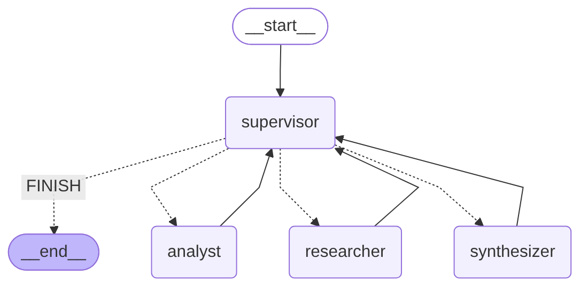
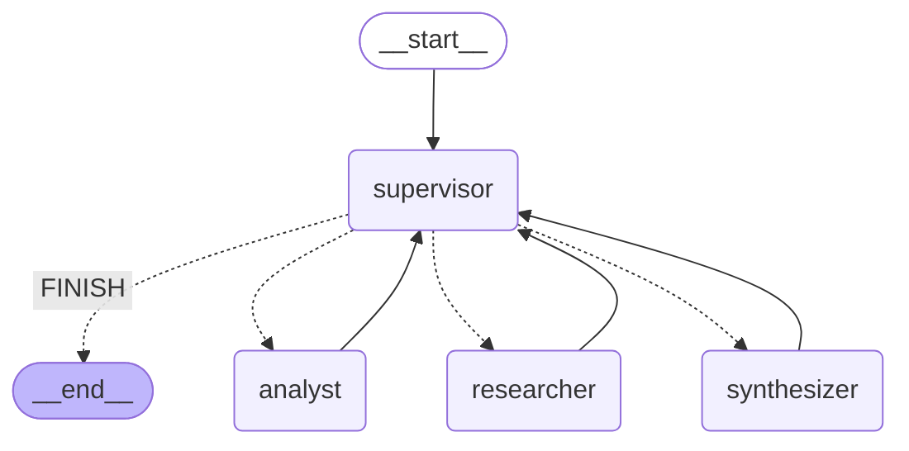

# Pre-entrega 6 · Orquestador multi-agente especializado

Prototipo de un **orquestador multi-agente de análisis e investigación** con **LangGraph**. Recibe pedidos que requieren dos dominios de especialización, **investigación** (buscar reseñas y precios de productos) y **análisis** (sentimiento y estadísticas), más una fase de **síntesis** final. Un **supervisor** decide en cada paso quién trabaja, valida los resultados con una rúbrica y solo termina cuando la respuesta cumple los criterios de calidad.

```
👤 "Compará las opiniones sobre SoundMax Pro y AudioZen X: ¿cuál tiene mejor sentimiento,
    cuál es el precio promedio de cada uno y cuál me recomendarías?"

🧭 supervisor → 🔎 researcher → 🧭 supervisor → 📊 analyst → 🧭 supervisor → ✍️ synthesizer → 🧭 supervisor → FIN
```

| Requisito | Dónde está |
|---|---|
| Topología jerárquica con un supervisor como router y controlador de flujo | `supervisor.py` + `graph.py` |
| Agente de investigación con herramientas de búsqueda | `agents/research_agent.py`: `search_reviews`, `search_prices` |
| Agente de análisis y cómputo | `agents/analyst_agent.py`: `analyze_sentiment`, `compute_statistics` |
| Fase de síntesis final | `agents/synthesis_agent.py` |
| Estado compartido que registra qué aportó cada agente | `state.py`: `OrchestratorState(MessagesState)` con `contributions` y `decisions` |
| El supervisor decide si la tarea está completa o si alguien debe refinar | Rúbrica en `supervisor.py`: `evaluate_rubric()` + reglas en `apply_guards()` |
| Ruteo con `Literal` en las aristas condicionales | `Route = Literal["researcher", "analyst", "synthesizer", "FINISH"]` y `route_from_supervisor()` |
| Especialistas con `create_react_agent` y herramientas acotadas | `agents/research_agent.py` y `agents/analyst_agent.py` |
| Condición de parada (contra el "supervisor infinito") | `MAX_STEPS = 8`, `MAX_ROUNDS = 2` por especialista, `recursion_limit` |
| Aislamiento de contexto | Cada especialista recibe solo su instrucción y el contexto necesario |
| Diagrama del grafo | `graph.png` y la sección [Grafo](#grafo), generados con `get_graph().draw_mermaid()` |
| Demo del flujo de delegación | `demo.ipynb` |

## Estructura

```
pre-entrega-6-orquestador-multiagente/
├── state.py                  # Estado compartido y artefactos validados con Pydantic
├── supervisor.py             # Supervisor: rúbrica, decisión con LLM y reglas del sistema
├── graph.py                  # StateGraph, control de escritura por dueño y ejecución con traza
├── main.py                   # CLI: ejecuta un pedido y guarda la traza
├── agents/
│   ├── llm.py                # Modelos por rol (supervisor vs. especialistas) y fallback
│   ├── research_agent.py     # Investigador (create_react_agent + herramientas de búsqueda)
│   ├── analyst_agent.py      # Analista (create_react_agent + sentimiento y estadísticas)
│   └── synthesis_agent.py    # Sintetizador de la respuesta final (sin herramientas)
├── data/sources.py           # Fuentes externas simuladas: reseñas y precios de productos
├── demo.ipynb                # Demostración del flujo de delegación
├── graph.png / graph.mmd     # Diagrama del grafo
├── traces/                   # Trazas de ejecución en JSON
├── tests/                    # 15 tests con modelos guionados (sin API)
├── requirements.txt
└── .env.example
```

## Cómo correrlo

```bash
python3.12 -m venv .venv
source .venv/bin/activate
pip install -r requirements.txt
cp .env.example .env                    # y completá GOOGLE_API_KEY

python main.py                          # pedido de ejemplo
python main.py "¿Qué opinan los clientes del BassBoom 3 y cuánto cuesta?"
python -m pytest -q                     # tests (sin API)
```

**Notebook:** abrí `demo.ipynb` en VS Code y elegí el kernel del `.venv`, o ejecutalo desde la terminal. Con el plan gratuito de Gemini, esperá un minuto después de correr `main.py`, por el límite de pedidos por minuto:

```bash
jupyter nbconvert --to notebook --execute --inplace demo.ipynb
```

**Proveedores:** por defecto usa **Gemini**, que tiene plan gratuito. Con `LLM_PROVIDER=openai` u `anthropic` usa esos proveedores; el grafo, los agentes y la rúbrica no cambian.

## Grafo





Las flechas punteadas son la **arista condicional** del supervisor: `route_from_supervisor()` devuelve un `Literal["researcher", "analyst", "synthesizer", "FINISH"]`. Las flechas llenas son el **retorno** de cada especialista al supervisor, que valida antes de seguir. El diagrama se genera con `python main.py --mermaid`.

## Por qué una topología jerárquica

| Necesidad del problema | Cómo la resuelve la jerarquía |
|---|---|
| **Hay dependencias de orden**: no se puede analizar sin datos, ni sintetizar sin análisis | El supervisor es el único que decide el siguiente paso, y lo hace con la rúbrica a la vista |
| **Hay que validar antes de responder** | Ningún especialista llega a `END`: todos vuelven al supervisor, y solo él puede terminar, con la rúbrica completa |
| **Distintos modelos por rol** | El supervisor usa el modelo más capaz (`gemini-3.8-flash`), porque decide y valida; los especialistas usan uno liviano y barato (`gemini-flash-lite-latest`), porque hacen tareas acotadas con herramientas |
| **Trazabilidad** | Cada decisión y cada contribución quedan registradas en orden: se puede reconstruir quién hizo qué y por qué |

Una topología cooperativa (agentes que reaccionan a un pizarrón compartido) no aporta acá: el flujo es predecible y las tareas dependen unas de otras, así que no hay paralelismo que aprovechar, y sí el riesgo de bucles entre agentes sin nadie que arbitre.

## Estado compartido

```python
class OrchestratorState(MessagesState):          # messages: la conversación visible
    task: str                                     # el pedido del usuario
    next_agent: Route                             # decisión del supervisor (Literal)
    instruction: str                              # la tarea para el especialista elegido
    step: int                                     # turnos del supervisor
    research: Optional[ResearchFindings]          # ← escribe solo el investigador
    analysis: Optional[AnalysisResult]            # ← escribe solo el analista
    final_answer: Optional[str]                   # ← escribe solo el sintetizador
    contributions: Annotated[list[Contribution], operator.add]        # quién aportó qué
    decisions: Annotated[list[SupervisorDecision], operator.add]      # qué decidió el supervisor
```

- **Artefactos validados:** `ResearchFindings` y `AnalysisResult` son modelos Pydantic, con puntajes de 1 a 5, sentimiento entre -1 y 1 y precios positivos. Se construyen con **los resultados de las herramientas**, no con el texto del LLM: los datos no se pueden inventar.
- **Trazabilidad:** cada `Contribution` registra el agente, la ronda (1 = primer intento, 2 = refinamiento), la instrucción que recibió, las herramientas que usó y su resumen. Cada `SupervisorDecision` registra el paso, el destino, el motivo, el estado de la rúbrica y si una regla del sistema corrigió al LLM.
- **Sin pérdida de contexto:** `contributions` y `decisions` usan el reducer `operator.add`, así que cada nodo **agrega** sin pisar lo anterior. En un refinamiento, el investigador **suma** productos a los ya encontrados (`merge_findings`).
- **Dueño de cada parte:** `graph.py` envuelve cada nodo con un control (`guarded`) que lanza `StateOwnershipError` si un agente intenta escribir la parte de otro. El analista, por ejemplo, no puede modificar `research`.

## El supervisor: rúbrica, decisión y reglas

En cada turno:

1. **Calcula la rúbrica con código**, no con el LLM, así que no se puede "alucinar" como completa:

   | Ítem | Criterio |
   |---|---|
   | `research_complete` | Cada producto pedido fue encontrado, con al menos 3 reseñas y al menos 1 precio |
   | `analysis_complete` | Cada producto encontrado tiene sentimiento y estadísticas |
   | `analysis_consistent` | La cantidad de reseñas analizadas coincide con la investigada |
   | `final_answer_ready` | El sintetizador entregó la respuesta |

2. **Le pide la decisión al LLM** con salida estructurada (`RouteDecision`: `next_agent`, `instruction`, `reason`). Le pasa el pedido, la rúbrica, los problemas detectados ("falta investigar AudioZen X") y un resumen de las contribuciones.

3. **Aplica reglas del sistema** que el LLM no puede saltear:
   - **No hay `FINISH` sin respuesta final:** si el LLM quiere terminar antes, va al paso que falta.
   - **No se analiza ni se sintetiza con la investigación incompleta**, mientras el investigador tenga rondas disponibles. En ese caso se lo manda a **refinar**, con una instrucción que dice exactamente qué falta.
   - **Presupuesto de refinamiento:** cada especialista trabaja como máximo 2 veces.
   - **Límite de pasos:** al llegar a 8, se fuerza la síntesis con lo disponible, aclarando qué faltó.
   - **Si el LLM del supervisor falla** (por ejemplo, un 503), decide el plan determinístico que se deriva de la rúbrica. El grafo nunca queda trabado.

### Ejemplo de refinamiento

Del test `test_incomplete_research_is_refined_before_analysis`: en su primera ronda, el investigador solo buscó un producto. El LLM del supervisor quiso pasar al análisis igual, y la regla lo corrigió:

```
🔎 researcher (ronda 1) | herramientas: search_reviews(SoundMax Pro), search_prices(SoundMax Pro)

🧭 supervisor (paso 2) [investigación✗ análisis✗ consistencia✗ respuesta✗] → researcher ⚠ regla del sistema
   motivo: [regla del sistema] la investigación está incompleta (el LLM había elegido analyst)
   instrucción: Buscá reseñas y precios. Pendiente: falta investigar AudioZen X; [...]

🔎 researcher (ronda 2) | herramientas: search_reviews(AudioZen X), search_prices(AudioZen X)

🧭 supervisor (paso 3) [investigación✓ análisis✗ consistencia✗ respuesta✗] → analyst
```

## Cómo se manejan los conflictos entre agentes

| Conflicto posible | Cómo se evita o se resuelve |
|---|---|
| **Un agente pisa el trabajo de otro** | Cada parte del estado tiene un único dueño, y el control `guarded` lo hace cumplir |
| **Datos contradictorios** (por ejemplo, el analista "dice" un promedio distinto al real) | Los números del estado salen de las herramientas, no del texto. El ítem `analysis_consistent` verifica que el análisis cubra las mismas reseñas que la investigación |
| **El analista concluye algo que los datos no respaldan** | El sintetizador recibe los datos **estructurados** y tiene la regla de usar solo esos números. La interpretación del analista va como contexto, no como fuente de verdad |
| **Corrección infinita entre agentes** ("el supervisor infinito") | Hay como máximo 2 rondas por especialista y 8 pasos por tarea; al agotarse, se sintetiza con lo disponible y se aclaran las limitaciones |
| **Un especialista falla** (error del proveedor) | Se registra en su `Contribution` con el error, el grafo sigue, y el supervisor decide reintentar o avanzar |
| **El LLM del supervisor elige mal** | Las reglas del sistema corrigen la decisión, y queda registrado (`overridden`) |

## Aislamiento de contexto

Ningún agente recibe todo el historial:

| Agente | Qué recibe |
|---|---|
| Supervisor | El pedido, la rúbrica, los problemas detectados y un resumen de cada contribución (no las reseñas ni las transcripciones de herramientas) |
| Investigador | Su instrucción; en un refinamiento, también la lista de lo que ya encontró |
| Analista | Su instrucción y la lista de productos con datos. Las reseñas las lee **a través de sus herramientas**, que están construidas sobre la investigación del estado: no puede buscar fuera de esos datos |
| Sintetizador | El pedido, la instrucción y los resultados estructurados del análisis (sin herramientas) |

## Herramientas

| Agente | Herramienta | Qué hace |
|---|---|---|
| Investigador | `search_reviews(product)` | Busca reseñas en la tienda, foros y blogs. Acepta alias y tildes ("soundmax"). Si el producto no existe, sugiere nombres parecidos |
| Investigador | `search_prices(product)` | Precios del producto en tres tiendas online |
| Analista | `analyze_sentiment(product)` | Sentimiento de las reseñas con un léxico en español que maneja negaciones ("no están mal" es positivo) y modificadores ("un poco caros"). Devuelve el puntaje de -1 a 1, el % de reseñas positivas y negativas, y los pros y contras por aspecto (batería, sonido, comodidad...) |
| Analista | `compute_statistics(product)` | Puntaje promedio, distribución de puntajes, precio promedio, precio mínimo y la tienda más barata |

Las fuentes son simuladas (`data/sources.py`), como permite la consigna. Reemplazarlas por Tavily, o por el índice de Pinecone de la pre-entrega 4, implica cambiar solo esas dos herramientas.

## Resultados (corridas reales)

### Corrida normal (`python main.py`, Gemini)

```
🧭 supervisor (paso 1) [investigación✗ análisis✗ consistencia✗ respuesta✗] → researcher
   instrucción: Busca reseñas (al menos 3 por producto) y precios (al menos 1 por producto) para los auriculares SoundMax Pro y AudioZen X.
🔎 researcher (ronda 1) | herramientas: search_reviews(SoundMax Pro), search_prices(SoundMax Pro), search_reviews(AudioZen X), search_prices(AudioZen X)

🧭 supervisor (paso 2) [investigación✓ análisis✗ consistencia✗ respuesta✗] → analyst
   instrucción: Analizar las 6 reseñas y los precios obtenidos para SoundMax Pro y AudioZen X, calculando el sentimiento, los puntajes y el precio promedio de cada producto.
📊 analyst (ronda 1) | herramientas: compute_statistics(SoundMax Pro), analyze_sentiment(SoundMax Pro), compute_statistics(AudioZen X), analyze_sentiment(AudioZen X)

🧭 supervisor (paso 3) [investigación✓ análisis✓ consistencia✓ respuesta✗] → synthesizer
✍️ synthesizer (ronda 1)

🧭 supervisor (paso 4) [investigación✓ análisis✓ consistencia✓ respuesta✓] → FINISH

✅ Respuesta final (12.3 s):
El SoundMax Pro tiene mejor sentimiento en las reseñas, registrando un puntaje de 0.33 y un promedio de 4.17
estrellas, frente al AudioZen X, que tiene un puntaje de sentimiento de 0.0 y un promedio de 2.83 estrellas.
El precio promedio del SoundMax Pro es de $182.000, mientras que el del AudioZen X es de $88.667.
Existe una tensión en los datos: el modelo más económico (AudioZen X) es el peor valorado y presenta serias dudas
sobre su durabilidad, mientras que el más costoso ofrece mejor calidad general a pesar de duplicar su valor.
Te recomiendo el SoundMax Pro porque, aunque es más caro, garantiza mayor satisfacción en sonido, batería y comodidad.
```

- **Delegación:** el supervisor siguió el orden investigación → análisis → síntesis **por su cuenta**, sin que tuviera que intervenir ninguna regla del sistema. Cada paso avanzó cuando la rúbrica marcó completo el anterior.
- **Instrucciones:** el supervisor les pasó a los especialistas instrucciones concretas, con los productos, la cantidad mínima de reseñas y qué calcular.
- **Datos:** todos los números de la respuesta (4.17 y 2.83 estrellas, sentimiento 0.33 y 0.0, $182.000 y $88.667) salen de las herramientas, y coinciden con los tests.
- **Tensión en los datos:** el sintetizador explicó la tensión entre precio y valoración, como pide su prompt.

La traza completa está en [`traces/last_run.json`](traces/last_run.json).

### Prueba de resiliencia (real): cuota de Gemini agotada

Al ejecutar el notebook justo después de `main.py`, el plan gratuito de Gemini devolvió `429 RESOURCE_EXHAUSTED` (límite de pedidos por minuto). Esa traza quedó guardada en [`traces/rate_limit_run.json`](traces/rate_limit_run.json):

| Paso | Qué pasó |
|---|---|
| 1 | Supervisor → researcher, que completó la investigación |
| 2 | Supervisor → analyst, que **falló por el 429**. El error quedó registrado en su `Contribution` y el grafo siguió |
| 3 | El supervisor vio el error y lo mandó a **reintentar**, en su segunda y última ronda: volvió a fallar |
| 4 | **También falló el LLM del supervisor**: decidió el plan determinístico de la rúbrica. Con las rondas del analista agotadas, pasó a la síntesis |
| 5 | El sintetizador también recibió el 429 y devolvió un aviso con los datos disponibles. El grafo **terminó ordenadamente**, sin excepciones ni bucles |

A partir de esta prueba se agregó un **reintento con espera ante un 429** (`with_fallback` espera `RATE_LIMIT_WAIT_SECONDS`, 30 s por defecto, y reintenta una vez el mismo modelo). También dejó de reintentarse dos veces seguidas el mismo modelo cuando el de respaldo coincide con el principal. Con el plan gratuito conviene esperar un minuto entre corridas.

## Tests

```bash
python -m pytest -q
```

Usan un supervisor y especialistas **guionados** (devuelven decisiones y llamadas a herramientas predefinidas), así que no necesitan API. Cubren:

- **Flujo completo:** investigador → analista → sintetizador → FIN, validado con la rúbrica.
- **Refinamiento:** con la investigación incompleta, el supervisor manda a refinar indicando qué falta, y los resultados se combinan con los de la primera ronda.
- **No hay `FINISH` sin respuesta final.**
- **El "supervisor infinito" se corta:** con 2 rondas por especialista y como máximo 8 pasos, siempre se llega a una respuesta.
- **Fallas:** si falla el LLM del supervisor, decide el plan determinístico; si falla un especialista, el grafo sigue.
- **Datos:** un producto inexistente se informa sin inventar datos.
- **Estado:** el control de escritura por dueño funciona, y la rúbrica detecta productos faltantes.
- **Herramientas:** alias y sugerencias; combinación de rondas; sentimiento con negaciones; el analista no ve productos que no se investigaron.
- **Límites de tasa:** ante un 429, se espera y se reintenta una vez el mismo modelo; un respaldo igual al principal no se reintenta.

`create_react_agent` muestra un aviso de deprecación: en LangGraph 1.x se movió a `langchain.agents.create_agent`. Se usa igual porque es lo que pide la consigna, y el aviso se silencia en `pytest.ini`.
