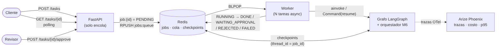
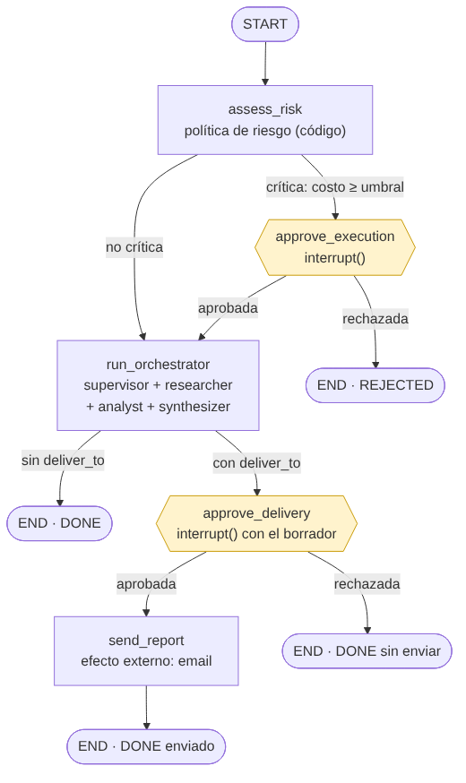

# Pre-entrega 7: API de producción y monitoreo activo

API REST con **FastAPI** que expone el **sistema multi-agente del módulo 6** (supervisor, investigador, analista y sintetizador) listo para producción. Incluye:

- **endpoints asíncronos**: el API encola la tarea y devuelve un `job_id` en milisegundos; los agentes corren en un worker;
- **Redis** para el estado de los jobs, la cola de trabajo y los **checkpoints de LangGraph**;
- **trazas en Arize Phoenix** de cada ejecución: costo, tokens y latencia por nodo;
- **aprobación humana (HITL)**: el grafo se pausa con `interrupt()` en las tareas críticas y espera una decisión externa.



## Estructura

```
pre-entrega-7-api-produccion/
├── app/
│   ├── main.py            # FastAPI: POST /tasks, GET /tasks/{id}, GET /tasks, GET /outbox, GET /health
│   ├── graph.py           # grafo de la tarea: riesgo → aprobación → orquestador M6 → aprobación → envío
│   ├── worker.py          # consume la cola, corre o reanuda el grafo y guarda cada estado (FAILED ante errores)
│   ├── hitl.py            # política de riesgo, nodos con interrupt() y POST /tasks/{id}/approve
│   ├── observability.py   # Phoenix: instrumentación de LangChain, spans de las fuentes y del job
│   ├── checkpointer.py    # checkpointer de LangGraph sobre Redis (o el RedisSaver oficial)
│   ├── jobs.py            # registro de jobs en Redis, cola y transiciones de estado atómicas
│   ├── schemas.py         # contratos Pydantic de la API (también son el esquema OpenAPI de /docs)
│   ├── config.py          # configuración por variables de entorno
│   └── orchestrator/      # el sistema multi-agente del módulo 6 (con las mejoras del módulo 7)
├── scripts/               # load_test.py (5 peticiones concurrentes + costo y p95 de Phoenix) · token_breakdown.py (tokens por agente)
├── tests/                 # 35 tests: API, worker, HITL, checkpointer y orquestador (sin servicios externos)
├── docs/                  # diagramas
├── screenshots/           # capturas del dashboard de Phoenix
├── results/               # informe de la prueba de carga (lo genera load_test.py)
├── Dockerfile · docker-compose.yml
├── requirements.txt · .env.example · pytest.ini
```

## El flujo de un job

```
POST /tasks ─► PENDING ─► RUNNING ─┬─► DONE
                                    ├─► WAITING_APPROVAL ─► (POST /approve) ─► PENDING ─► RUNNING ─► DONE / REJECTED
                                    └─► FAILED   (excepción o timeout: el error queda en el job)
```

1. **`POST /tasks`** valida el pedido, guarda el job en Redis como `PENDING` y lo encola, **en una sola transacción**: el registro siempre existe antes de que un worker lo tome. Responde **202** con el `job_id`. No llama a ningún LLM.
2. Un **worker** saca el mensaje con `BLPOP`. `BLPOP` bloquea hasta que llega trabajo, así que el worker no consulta Redis en un bucle. El worker pasa el job a `RUNNING` y corre el grafo con `thread_id = job_id`.
3. El grafo termina o se pausa en un nodo de aprobación. El worker guarda `DONE`, `REJECTED` o `WAITING_APPROVAL`, junto con el resultado, el flujo de agentes, el `trace_id` de Phoenix y el tiempo de ejecución.
4. Si algo falla (una excepción del agente, un timeout o un error de Redis), el job queda en **`FAILED` con el error**. El cliente nunca se queda haciendo polling para siempre.



## Human-in-the-loop

Hay dos momentos en que el sistema le pide permiso a una persona. Los dos son nodos del grafo que lo pausan con `interrupt()`:

| Etapa | Cuándo | Qué ve el revisor | Si rechaza |
|---|---|---|---|
| `execution` | Antes de correr una tarea **crítica por costo**: el costo estimado alcanza `HITL_COST_THRESHOLD_USD` (con los valores por defecto, 3 productos o más) | Los motivos y el costo estimado | El job queda `REJECTED` y **no se gasta ningún token** |
| `delivery` | Antes de **enviar el informe por email** (`deliver_to`): un efecto externo que no se puede deshacer | El **borrador** y el destinatario | La respuesta queda en el job, pero no se envía nada |

**La política de riesgo es código, no un LLM:** la misma tarea siempre recibe la misma decisión. El costo estimado está calibrado con las trazas del módulo 7: unos US$ 0,0022 fijos más US$ 0,0017 por producto (q2, con 3 productos, costó US$ 0,0073).

**Cómo funciona la pausa:**
- `interrupt()` detiene el grafo y el checkpointer guarda el estado en Redis. El worker marca el job `WAITING_APPROVAL` y queda libre: nadie espera en memoria.
- `POST /tasks/{id}/approve` hace una transición atómica de `WAITING_APPROVAL` a `PENDING` y encola un `resume`. Si dos revisores aprueban a la vez, el segundo recibe **409**.
- Un worker corre `Command(resume=decisión)`, y `interrupt()` devuelve esa decisión dentro del nodo.
- Funciona aunque la API se haya **reiniciado** en el medio: el estado vive en Redis, no en memoria.
- Cada decisión queda en `approvals`, con revisor, comentario y fecha, para auditoría.
- Al reanudar, el nodo vuelve a correr desde el principio. Por eso no tiene nada con efectos antes del `interrupt()`: el email se envía en el nodo siguiente, `send_report`.

## Cómo ejecutarlo

Usá el `.venv` del repo, con Python 3.12.

### 1. Instalar

```bash
cd modulo-07-observabilidad/pre-entrega-7-api-produccion
pip install -r requirements.txt
cp .env.example .env      # completá GOOGLE_API_KEY (o usá el .env de la raíz del repo)
```

### 2. Levantar Redis (cualquiera de estas opciones)

El checkpointer por defecto (`CHECKPOINTER=redis`) usa solo comandos básicos de Redis, así que **funciona con cualquier Redis**:

| Opción | Comando |
|---|---|
| **Docker** (recomendada) | `docker compose up -d redis` (o `docker run -d -p 6379:6379 redis:8`) |
| Homebrew (Mac) | `brew install redis && brew services start redis`. Si se pone a compilar `cmake`, primero actualizá las Command Line Tools con `softwareupdate --list` y `softwareupdate --install "<Command Line Tools …>"` |
| Redis Cloud (gratis, sin instalar nada) | Creá una base en <https://redis.io/try-free> y poné su URL en `REDIS_URL=redis://default:<clave>@<host>:<puerto>` |

Comprobá que responda con `redis-cli ping` (tiene que dar `PONG`), o con `GET /health` una vez que la API esté levantada.

### 3. Levantar Phoenix (en otra terminal)

```bash
python -m phoenix.server.main serve      # dashboard en http://localhost:6006
```

### 4. Levantar la API (en otra terminal)

```bash
uvicorn app.main:app --reload            # documentación interactiva en http://localhost:8000/docs
```

El worker arranca dentro de la API: son `WORKER_CONCURRENCY` tareas async en el mismo event loop. Para correrlo como **proceso separado**, levantá la API con `RUN_WORKER_IN_API=false` y en otra terminal corré `python -m app.worker`. Podés levantar varios: `BLPOP` le entrega cada mensaje a uno solo.

**Todo junto con Docker Compose:** `docker compose up --build` levanta Redis, Phoenix, la API y un worker. Para más workers: `--scale worker=3`.

### 5. Probarlo

```bash
# Una tarea normal (no crítica): termina sola
curl -X POST localhost:8000/tasks -H "Content-Type: application/json" \
     -d '{"task": "Compará SoundMax Pro y AudioZen X: sentimiento y precio promedio"}'
curl localhost:8000/tasks/<job_id>

# Una tarea crítica (3 productos): queda en WAITING_APPROVAL hasta que alguien decida
curl -X POST localhost:8000/tasks -H "Content-Type: application/json" \
     -d '{"task": "Armá un ranking de SoundMax Pro, AudioZen X y BassBoom 3 según el sentimiento"}'
curl -X POST localhost:8000/tasks/<job_id>/approve -H "Content-Type: application/json" \
     -d '{"approved": true, "reviewer": "javier", "comment": "costo aceptable"}'

# Con envío por email: pide aprobación del borrador antes de mandarlo
curl -X POST localhost:8000/tasks -H "Content-Type: application/json" \
     -d '{"task": "¿Qué opinan de los BassBoom 3?", "deliver_to": "cliente@ejemplo.com"}'
curl localhost:8000/outbox                # los "emails" enviados (solo después de aprobar)
```

**Prueba de reinicio:** creá una tarea crítica y esperá a que quede en `WAITING_APPROVAL`. Cortá la API con Ctrl+C, volvé a levantarla y aprobala: el job sigue desde donde se pausó, porque el estado del grafo está en Redis.

### 6. Prueba de carga: las 5 peticiones concurrentes

```bash
python scripts/load_test.py
```

El script hace esto:
- manda los 5 `POST /tasks` **al mismo tiempo** y mide cuánto tardó cada uno (milisegundos: solo encolan);
- consulta el estado de cada job hasta que termina;
- le pide a **Phoenix**, por su API GraphQL, el **costo de cada ejecución** (lo calcula Phoenix a partir de los tokens y del modelo) y el **p50 y el p95 de la latencia** de las trazas;
- guarda el informe en `results/load_test.md`.

**Plan gratuito de Gemini:** los 5 jobs hacen unas 50 llamadas al LLM, y el plan gratuito acepta alrededor de 15 por minuto. Un rate limiter compartido (`InMemoryRateLimiter` de LangChain) espacia las llamadas para no recibir 429 en ráfaga: con Gemini, por defecto son 12 por minuto (`LLM_REQUESTS_PER_MINUTE`). La prueba tarda unos minutos, y esa espera se ve en la latencia de los spans LLM. Para que sea más rápida, usá el mismo modelo en todos los roles: `GEMINI_MODEL=gemini-flash-lite-latest python ...`. También podés usar `LLM_PROVIDER=fake`, el modelo offline, para probar todo sin gastar cuota (pero el costo da 0, porque Phoenix no tiene precio para ese modelo).

**Tokens por agente:** la tabla de trazas de Phoenix muestra cada llamada como "ChatGoogleGenerativeAI", sin decir qué agente la hizo. Ese dato está en la metadata de cada span (`langgraph_checkpoint_ns`), y este script lo agrupa por agente:

```bash
python scripts/token_breakdown.py            # → results/token_breakdown_<proyecto>.md
```

Muestra, por agente, las llamadas, las fallidas (429/503), los tokens, el costo y los segundos en el LLM. Responde "qué nodo consume más tokens".

### 7. Capturas del dashboard

Ver [`screenshots/README.md`](screenshots/README.md): qué capturar y en qué pantalla de Phoenix.

## Resultados: prueba de carga y lectura del dashboard

Corrida del 16/11/2026: 5 peticiones concurrentes con `scripts/load_test.py`, proyecto `pe7-api-agente` de Phoenix. Configuración: `gemini-3.8-flash` en el supervisor y `gemini-flash-lite-latest` en los especialistas y como respaldo, plan gratuito. Ese día la **cuota diaria de `gemini-3.8-flash` (20 pedidos) ya estaba agotada**, y eso explica casi todo lo que sigue.

Informes completos: [`results/load_test.md`](results/load_test.md) y [`results/token_breakdown_pe7-api-agente.md`](results/token_breakdown_pe7-api-agente.md).

### Lo que pide la consigna

| Métrica | Valor | Evidencia |
|---|---|---|
| Estados finales | **5 de 5 `DONE`**, ninguno `FAILED` | [`01-trazas.png`](screenshots/01-trazas.png) |
| Respuesta del `POST /tasks` | 119 ms el más lento; ningún job esperó más de 0,05 s en la cola | `results/load_test.md` |
| **Latencia p95** (calculada por Phoenix) | **422,62 s** (p50: 354,70 s; max: 436,70 s) | [`03-latencia-p95.png`](screenshots/03-latencia-p95.png) |
| **Costo por ejecución** (calculado por Phoenix) | **US$ 0,0051 de promedio** (entre 0,0042 y 0,0059); US$ 0,0254 la corrida | [`04-costo.png`](screenshots/04-costo.png) |
| Tokens | 29.874 de entrada + 6.324 de salida = 36.198 | `04-costo.png` |

**Phoenix y la API miden lo mismo.** El p95 de las trazas (422,62 s) coincide con el que mide la API (422,63 s), y los tokens y el costo coinciden al dígito con la suma por job del script. En la tabla de trazas el costo aparece como "<$0.01", porque Phoenix redondea los montos chicos. El valor exacto está en `load_test.md`, que lo lee de Phoenix por GraphQL.

### Dónde se concentra la latencia

| Componente | Tiempo | Evidencia |
|---|---|---|
| Llamadas al LLM | **1.390 s de los 1.753 s de ejecución (79 %)** | `token_breakdown` |
| … de ellas, llamadas que fallaron por la cuota (429) | **740 s (53 % del tiempo en el LLM)**, todas del supervisor | `token_breakdown`, [`05-tokens-por-nodo.png`](screenshots/05-tokens-por-nodo.png) |
| El resto: esperas de 30 s después de cada 429 (fuera de los spans) y orquestación | 363 s (21 %) | log de la API |
| Herramientas y base de datos | **milisegundos**: `search_reviews` 57 ms, `db.reviews.search` 52 ms | [`02b-agente-herramienta-modelo.png`](screenshots/02b-agente-herramienta-modelo.png) |

**Lectura:**
- La latencia es casi toda de la API de Gemini, y en esta corrida, sobre todo de **esperar a un modelo que no podía responder**. En [`02-arbol-de-una-traza.png`](screenshots/02-arbol-de-una-traza.png), el supervisor tarda 1m 39s, y su primera llamada se lleva 47 s sola (el SDK reintenta el 429). En `05`, las llamadas fallidas tienen **0 tokens y costo "--"**: no cuestan dinero, pero sí tiempo, una de ellas 1m 7s.
- En [`04-costo.png`](screenshots/04-costo.png) se ve lo mismo: `gemini-3.8-flash` casi no aparece en el costo, porque respondió 1 vez de 32.
- En el gráfico **Traces**, las 5 trazas figuran como *error* aunque terminaron en `OK`: Phoenix marca una traza como error si falló cualquier span de adentro.

### Qué nodo consume más tokens

| Agente | Llamadas (fallidas) | Tokens entrada | Tokens salida | % de los tokens | Costo | % del costo |
|---|---|---|---|---|---|---|
| supervisor | 51 (31) | 12.434 | 1.741 | **39 %** | US$ 0,0087 | 34 % |
| analyst | 10 (0) | 5.350 | **3.065** | 23 % | US$ 0,0093 | **37 %** |
| researcher | 10 (0) | 6.397 | 644 | 19 % | US$ 0,0035 | 14 % |
| synthesizer | 5 (0) | 5.693 | 874 | 18 % | US$ 0,0039 | 15 % |

- **El que más tokens consume es el supervisor** (39 %): decide 4 veces por job y cada vez recibe la rúbrica y las contribuciones.
- **El que más cuesta es el analista** (37 % del costo con el 23 % de los tokens): es el que más tokens de **salida** produce, y la salida cuesta unas 8 veces más que la entrada. En el total de la corrida, la salida es el 17 % de los tokens pero cerca de **dos tercios del costo** (unos US$ 0,016 de 0,025; `04-costo.png` lo muestra redondeado: completion US$ 0,02 contra prompt <US$ 0,01).

### Observaciones de eficiencia y mejoras

1. **Aplicada:** la cuota diaria ya no se reintenta. El código trataba cualquier 429 como un límite por minuto: esperaba 30 s y reintentaba un modelo que no iba a responder por 8 horas. Ahora, si el error es de cuota diaria (`PerDay`), pasa directo al modelo de respaldo, sin esperar. También recuerda que ese modelo está agotado hasta la hora que indica Google (`retryDelay`), así que de las 31 llamadas fallidas solo fallaría la primera (`with_fallback` en `agents/llm.py`, con su test). En esta corrida eso eran unos 740 s en llamadas fallidas, más las esperas de 30 s.
2. **Propuesta:** la primera decisión del supervisor (siempre `researcher`) y la última (`FINISH`) se pueden tomar en código, sin LLM. Son 2 de las 4 llamadas del agente que más tokens consume.
3. **Propuesta:** acotar la salida del analista. Si devolviera solo los números estructurados y no un texto largo, se ahorraría la parte más cara: el 37 % del costo.
4. **Operativa:** con el plan gratuito, el cuello de botella no es la arquitectura sino la cuota. La API y los workers respondieron en milisegundos todo el tiempo.

## Observabilidad

| Qué | Cómo |
|---|---|
| Cada ejecución de un job | Span raíz `job.start` o `job.resume`, con `session_id = job_id`: en Phoenix → **Sessions** se ven juntas todas las corridas de un job (la inicial y la reanudación después de aprobar) |
| Nodos del grafo, agentes, llamadas al LLM (modelo y tokens) y herramientas | `LangChainInstrumentor` de OpenInference |
| Fuentes de datos (reseñas y precios) | Spans `RETRIEVER` hechos a mano, colgados de la herramienta que los llamó |
| Costo | Phoenix lo calcula solo: tiene la lista de precios de `gemini-3.8-flash` y `gemini-flash-lite-latest`, y la cruza con los tokens de cada span LLM |
| Atributos en todos los spans | `session_id`, tags (`pe7`, `start`/`resume`), `metadata.job_id` y `prompt_template_version` |
| `trace_ids` en el job | `GET /tasks/{id}` devuelve el id de cada traza, para buscarla en Phoenix |

Las peticiones HTTP **no** se trazan: FastAPI ≥ 0.16x las traza solo si hay un proveedor de OpenTelemetry, y cada consulta de polling sería una traza de 5 ms que bajaría el p50/p95 del proyecto. Así, cada traza del proyecto es una ejecución de agentes.

## Decisiones de diseño

| Decisión | Por qué |
|---|---|
| Worker separado del request | Un flujo multi-agente tarda de 10 s a varios minutos: dentro del request, la conexión se corta por timeout y el servidor se queda sin recursos |
| Todo async (`redis.asyncio`, `graph.ainvoke`, `ChatGoogleGenerativeAI` async) | Nada bloquea el event loop: la API responde mientras los workers trabajan (el POST tarda ~40 ms con 5 jobs corriendo) |
| Registro + encolado en una transacción (`MULTI`) | El job siempre existe antes de que un worker lo tome: no hay 404 en el primer polling |
| Transiciones con `WATCH`/`MULTI` (compare-and-set) | Dos revisores no pueden aprobar el mismo job, y un worker no puede tomar un job que ya no está `PENDING` |
| `FAILED` ante cualquier excepción, y timeout por job (`JOB_TIMEOUT_SECONDS`) | El "error común" de la consigna: si el agente falla en segundo plano, el cliente se entera |
| Checkpointer propio sobre Redis básico | El `RedisSaver` oficial necesita los módulos Search y JSON (Redis 8 en Docker, Redis Stack o Redis Cloud): con un Redis común responde `unknown command 'FT.INFO'`. El propio replica el `InMemorySaver` de LangGraph con hashes de Redis y funciona con cualquier Redis. El oficial se activa con `CHECKPOINTER=langgraph-redis` |
| El orquestador M6 como **subgrafo** | Hereda el checkpointer: cada paso de cada agente también queda guardado |
| Grafo compilado una sola vez | Es seguro compartirlo: cada job es otro `thread_id` |
| Rate limiter compartido | El plan gratuito limita las llamadas por minuto: es mejor espaciarlas que recibir 429 |
| Volumen con AOF en Docker (`--appendonly yes`) | Los jobs y checkpoints sobreviven a un reinicio de Redis |

**Mejora aplicada desde el módulo 7:** las herramientas del investigador ahora **atrapan los errores de las fuentes** y los devuelven como datos (`source_unavailable`). En el módulo 7, con la fuente de reseñas caída, la excepción tumbaba al agente entero y nunca se pedían los precios.

## Tests

```bash
python -m pytest -q
```

Son 35 tests y no necesitan Redis, Phoenix ni API key: usan `fakeredis` y el modelo offline (`LLM_PROVIDER=fake`).

| Archivo | Qué prueba |
|---|---|
| `test_api.py` | POST sin bloquear, 404/422, el worker corriendo el sistema completo, `FAILED` por excepción y por timeout, la política de riesgo, aprobar, rechazar, doble aprobación (409), el envío solo después de aprobar, la aprobación después de un reinicio, 5 jobs en paralelo y el rate limiter compartido |
| `test_checkpointer.py` | Un `interrupt` que sobrevive a un reinicio, subgrafos (namespaces), historial, `before`/`limit`, borrado y TTL |
| `test_orchestrator.py` | Los 15 tests del módulo 6, más el de la fuente caída del módulo 7 y el de la cuota diaria agotada |

## Modo offline (sin API key)

`LLM_PROVIDER=fake` usa un modelo de reglas fijas: el supervisor sigue la rúbrica, los especialistas llaman a sus herramientas y el sintetizador redacta con los números del análisis. **No es un LLM**: sirve para probar la API, Redis, el HITL y las trazas sin gastar cuota, y es el que usan los tests.

## Limitaciones

- Si un worker muere en medio de un job (un `kill -9` o un corte de luz), el job queda en `RUNNING`. Su checkpoint está en Redis, así que se podría reanudar; falta un proceso que detecte esos jobs y los vuelva a encolar.
- El envío de email es simulado: escribe en la lista `outbox` de Redis.
- La estimación de costo para el HITL es un modelo lineal calibrado con 7 trazas: es una regla de negocio, no una predicción exacta.
